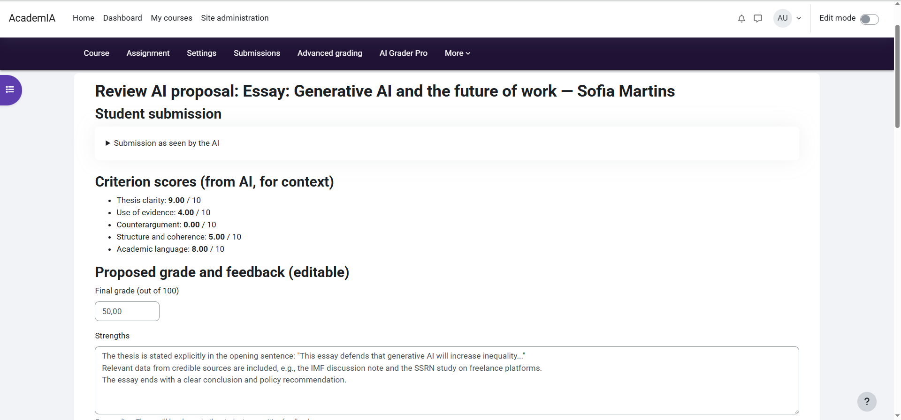

# Summary

AI Grader Pro is a free, open-source plugin (GPL-3.0-or-later) for the Moodle learning management system that adds AI-assisted grading to the standard *Assignment* activity. For each submission, a large language model (LLM) proposes a grade per assessment criterion and a structured piece of feedback; the teacher reviews, edits and decides. Nothing reaches the gradebook without an explicit teacher action, even when proposals are prepared automatically on submission (an option, off by default).

The plugin is built on the AI subsystem introduced in Moodle 4.5 [@MoodleAISubsystem], so institutions can use whichever LLM provider they have already configured (OpenAI, Azure OpenAI, Groq and others) without vendor lock-in or additional credentials. It reads documents (PDF, Word, PowerPoint, OpenDocument, Markdown), source code in 24 file types, Jupyter notebooks and ZIP projects, and a class report summarises each assignment for the teacher. The interface is available in five languages, and in Mexican Spanish through Moodle's community translation system.

AI Grader Pro is distributed through the Moodle Marketplace, Moodle's official plugin directory, where it holds the *Privacy friendly*, *Automated testing support* and *Early bird 5.3* awards. Its source code is archived on Zenodo [@AIGraderProZenodo].

# Statement of need

Frequent, low-stakes assignments with timely feedback improve learning [@BlackWiliam1998; @HattieTimperley2007], but in large courses they are rarely feasible: the grading load exceeds what instructors can absorb, so such tasks are either not set or returned without comments. Generic chatbots do not fit an institutional setting: student work goes to third-party services, with no control over criteria and no record of what the teacher decided [@Kasneci2023].

Existing tools cover only part of this gap. Autograders such as CodeRunner [@LobbHarlow2016] and VPL [@RodriguezDelPino2022] in Moodle, or nbgrader [@nbgrader2019] for Jupyter notebooks, evaluate programs against tests and leave open-ended written work to manual grading, and their feedback rarely goes beyond which tests pass [@Messer2024]. Several Moodle plugins already grade with LLMs: AI Grade [@AIGradePlugin] and AutoGrade [@AutoGradePlugin] save the AI's grade directly for the teacher to adjust afterwards, AI Text [@AITextPlugin] grades quiz answers as students submit, and Assignment AI [@AssignmentAIPlugin] keeps grades as drafts but sends submissions to its vendor's paid service. AI Grader Pro was designed for the remaining case: criterion-based assessment of written and programming work, inside Moodle, with the teacher retaining the final decision and the institution retaining control of the model provider and of student data.

The design choices follow from that goal. *Teacher-in-the-loop by default* reflects evaluations of LLM grading that report useful but imperfect agreement with human graders [@Kortemeyer2024; @Grevisse2024], and makes the tool usable under the transparency and human-oversight expectations of the EU Artificial Intelligence Act [@EUAIAct2024]. *Provider-agnostic integration* through Moodle's AI subsystem lets each institution apply its own policy on which models may be used. *Anonymisation before every call* and *an audit trail of proposals and decisions* address the requirements of the General Data Protection Regulation [@GDPR2016] and make the grading process inspectable afterwards.

The intended users are instructors who want to give feedback on weekly or formative deliverables that would otherwise go uncorrected, and Moodle administrators who need an AI tool they can deploy under institutional governance. In computing courses, where deliverables are code, notebooks or whole projects, teachers can also grade what tests cannot check, such as design, documentation or the justification of results.

# Story of the project

AI Grader Pro grew out of the author's own teaching. Students worked through guided lab sessions and regular deliverables, but with so many students the teaching staff could not grade them every week, so in practice the only graded assessments were two exams per course, and students received little feedback in between. The plugin was written to close that gap: the deliverables can now be graded every week, with written feedback for each student, while the teacher keeps the final decision. The class report, added in version 1.1, answers a related need: it summarises the weak points, common misconceptions and topics to reinforce in class. The first version was published in May 2026.

# Use in teaching

The plugin was tested on 12 real assignment submissions that their teacher had already graded. No proposal was below the teacher's grade (mean absolute error 0.67 points out of 10; 8 of the 10 proposals within ±1 point). This was a single run with one teacher as the reference. Both the quality of the proposals and how much context the model can take in depend on the AI provider and model that each institution configures.

The plugin was piloted at the University of Oviedo from January to May 2026, in two lab groups of a Databases course, with 30 students, whose lab deliverables were graded with AI Grader Pro. All the students who used it and sat the exams passed, a higher pass rate than in previous years or in other lab groups; the pilot was not designed as a controlled study, so this cannot be attributed to the plugin alone. The students' opinion of the tool was positive. It was also used in the *University Microcredential in Artificial Intelligence: Fundamentals and Applications with Python*, with 15 students, of whom 14 submitted the lab assignments, and all 14 passed.

Beyond these courses, the Moodle Marketplace statistics show the plugin installed on 53 Moodle sites in October 2026, up from 15 in April, and 247 downloads between June and September 2026.

# Design and implementation

AI Grader Pro is a Moodle *local* plugin written in PHP 8.1 and later, compatible with Moodle 4.5 to 5.3. It adds its settings to the Assignment activity's settings form, writes grades through the Assignment API, and reaches the model through the AI subsystem's provider abstraction. Submissions are converted to text, identifiers are replaced by placeholders, and a prompt built from the teacher's criteria is sent to the configured provider. Responses are parsed into per-criterion grades and feedback, stored with the audit record, and presented in a review interface (\autoref{fig:review}) where the teacher can edit and publish each proposal, keep it as an unpublished draft, or publish several unedited proposals at once.

The project ships with 148 PHPUnit tests and 18 Behat acceptance scenarios, and is checked by a continuous-integration matrix across Moodle versions, PHP 8.1 to 8.4, MariaDB and PostgreSQL.

# Acknowledgements

This work received no specific funding.

# References
